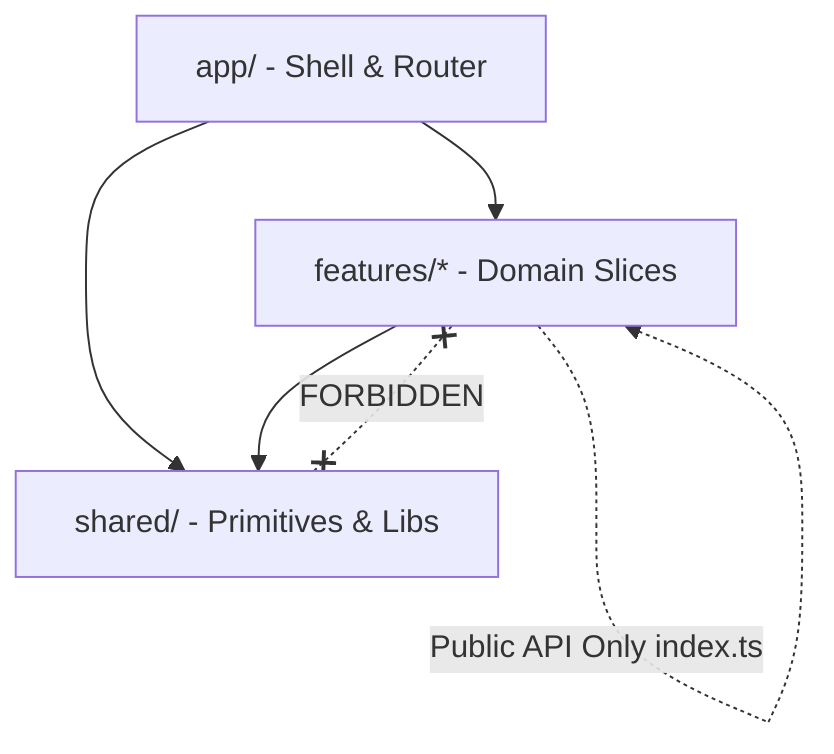

# Feature-Based Architecture & Development Reference

Design modular, scalable, and maintainable frontend web applications using Feature-Based Architecture (Vertical Slices / Feature-Sliced Design). Prevent codebase entropy, eliminate spaghetti dependencies, and enable autonomous team delivery.

---

## 1. Why Feature-Based Over Layer-Based Architecture?

Traditional web applications group files by technical layer:

```text
❌ Layer-Based (Anti-Pattern at Scale):
src/
  components/       # 200+ mixed UI components
  hooks/            # 80+ disparate React hooks
  services/         # Dozens of API calls with no clear domain owner
  types/            # Monolithic global types file
```

**Failure Mode**: When building or modifying a feature (e.g., "Team Invites"), developers must touch 6 different folders across the repository. Unrelated features depend on each other's private utilities, creating tight coupling and making it impossible to delete or refactor features cleanly.

### The Vertical Slice Solution

Group code by **business domain / feature** rather than technical role. Everything required for a feature to function lives inside its self-contained feature directory.

```text
✅ Feature-Based (Vertical Slices):
src/
  app/              # Global providers, routing shell, layout
  features/         # Domain-driven feature slices
    billing/        # Self-contained billing slice
    team/           # Self-contained team management slice
    analytics/      # Self-contained analytics & reporting slice
    auth/           # Self-contained authentication & session slice
  shared/           # Reusable, domain-agnostic UI primitives and utilities
```

---

## 2. Standard Anatomy of a Feature Slice

Every feature slice must adhere to this predictable internal structure:

```text
src/features/billing/
├── api/
│   ├── useSubscriptionQuery.ts     # TanStack Query / SWR hooks
│   ├── useUpgradePlanMutation.ts   # Mutation hook with optimistic updates
│   └── billingApi.ts               # Raw fetch / client calls
├── components/
│   ├── PlanComparisonTable.tsx     # Feature-specific UI
│   ├── PricingCard.tsx
│   ├── UpgradePaywall.tsx          # Gated paywall modal
│   └── InvoiceHistoryList.tsx
├── hooks/
│   └── usePlanUpgradeCalculator.ts # Pure business logic / calculations
├── types/
│   ├── billingSchemas.ts           # Zod validation schemas
│   └── billingTypes.ts             # Inferred TypeScript types & DTOs
├── utils/
│   └── formatCurrency.ts           # Pure formatting utilities for this domain
└── index.ts                        # ⚠️ MANDATORY: Explicit Public API barrel
```

---

## 3. Strict Dependency & Boundary Rules

To prevent spaghetti dependencies across feature slices, enforce these architectural rules:



### Rule 1: The Public API Boundary (`index.ts`)
A feature must only export what external consumers (other features or `app/` routes) are explicitly allowed to use. Everything else is private to the feature.

```typescript
// src/features/billing/index.ts
// ✅ EXPORT explicitly what outside callers need:
export { UpgradePaywall } from './components/UpgradePaywall';
export { useSubscriptionQuery } from './api/useSubscriptionQuery';
export type { PlanTier, SubscriptionSummary } from './types/billingTypes';
export { BILLING_CAPABILITIES } from './types/billingSchemas';

// ❌ NEVER allow external features to import deep internals:
// import { InvoiceRawRow } from '@/features/billing/components/InvoiceRawRow'; // LINT VIOLATION!
```

### Rule 2: Shared Cannot Import From Features
`src/shared` contains domain-agnostic design system tokens, button primitives, HTTP clients, and math helpers. `shared/` must **NEVER** import from `features/`.

### Rule 3: Cross-Feature Coupling Minimization
If Feature A (`analytics`) needs data from Feature B (`billing`):
- Feature A may only import from `features/billing/index.ts`.
- Prefer passing shared state through route query parameters, global session context, or event emitters rather than tight hook coupling.

### Enforcing Boundaries with ESLint / Biome
Add `eslint-plugin-boundaries` or `import/no-restricted-paths` to your linter configuration:

```json
{
  "rules": {
    "import/no-restricted-paths": [
      "error",
      {
        "zones": [
          {
            "target": "./src/features/!(billing)/**/*",
            "from": "./src/features/billing/!(index.ts)*",
            "message": "Import from the feature's public index.ts only!"
          },
          {
            "target": "./src/shared/**/*",
            "from": "./src/features/**/*",
            "message": "Shared components cannot depend on feature slices!"
          }
        ]
      }
    ]
  }
}
```

---

## 4. Colocating Entitlements & Routing within Feature Slices

Each feature slice should declare its own:
1. **Entitlement Capabilities**: What subscription tier or permissions are required.
2. **Route Definitions / Page Components**: The route entry point, wrapped in Suspense and lazy-loaded.
3. **Navigation Items**: The menu item definition for the app shell.

```typescript
// src/features/analytics/index.ts
import React from 'react';
import type { RouteObject } from 'react-router-dom';

// Lazy-load the root feature page for bundle splitting
const AnalyticsDashboardPage = React.lazy(() => import('./components/AnalyticsDashboardPage'));

export const analyticsRoutes: RouteObject[] = [
  {
    path: 'analytics',
    element: <AnalyticsDashboardPage />,
  },
];

export const analyticsNavigationItem = {
  id: 'analytics',
  label: 'Analytics & Insights',
  path: '/analytics',
  requiredCapability: 'analytics:custom_dashboards',
  badge: 'PRO',
};
```

---

## 5. Feature Deletion & Deprecation Drill

A major advantage of feature-based architecture is effortless feature retirement:

1. When a feature or experiment is obsolete, you delete the entire `src/features/<feature-name>/` directory.
2. If TypeScript compiles cleanly after removing the feature's route from `app/routes.ts`, you have achieved **zero orphaned dead code**.
3. If thousands of lines of dangling utilities or orphan styles remain across the codebase, your boundaries were violated.

---

## 6. Monorepo Scaling: From Feature Slice to Internal Package

When a feature matures, requires independent versioning, or is shared across multiple web apps (e.g., Customer Portal + Admin Backoffice), elevate the slice into an internal workspace package:

```text
packages/
  ├── ui/                   # Shared UI primitives (@acme/ui)
  ├── feature-billing/      # Isolated billing package (@acme/feature-billing)
  └── tsconfig/             # Shared TypeScript configuration
apps/
  ├── web-customer/         # Main customer-facing SaaS web app
  └── web-admin/            # Internal operations dashboard
```
